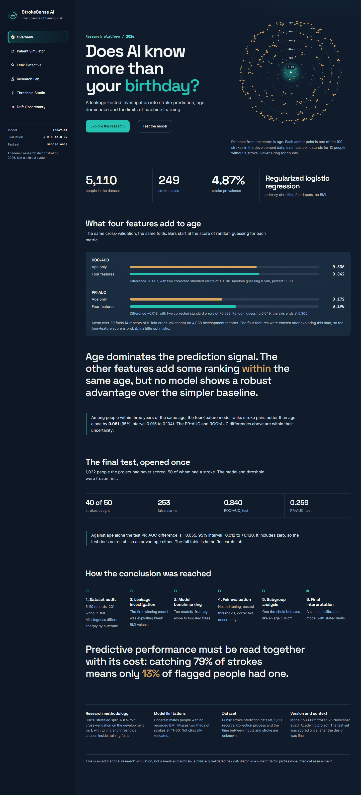

# StrokeSense AI

**Does AI know more than your birthday?** A leakage-tested study of stroke prediction, with an interactive research app.

> Educational research project. Not a diagnosis, not a validated risk calculator, not a substitute for medical assessment.



## What we found
1. **The best-looking model was exploiting blank BMI.** Boosting reached a PR-AUC of 0.214 when blanks were filled with one median, and 0.174 with BMI removed.
2. **Age carries most of the signal.** No model beats age alone clearly on PR-AUC or ROC-AUC. Among people of similar age, the four-feature model ranks stroke pairs better by 0.061 (95% interval 0.015 to 0.104).
3. **One threshold behaves like an age cut-off.** It flags nearly everyone above 60 and misses most strokes below.

## Results
Logistic regression on age, average glucose, hypertension and heart disease. The two columns are different evaluations and are never combined.

| Metric | Development, 4×5-fold CV mean (4,088 people) | Final test, scored once (1,022 people, 50 strokes; 95% interval) | Age only, same test |
|---|---|---|---|
| PR-AUC | 0.190 | 0.259 (0.168–0.372) | 0.204 (0.140–0.297) |
| ROC-AUC | 0.842 | 0.840 (0.777–0.893) | 0.834 (0.772–0.887) |
| Brier score | 0.043 | 0.041 (0.031–0.052) | 0.042 (0.032–0.053) |
| Sensitivity | 0.793 | 0.800 (0.670–0.888) | 0.840 (0.715–0.917) |
| Specificity | 0.733 | 0.740 (0.711–0.766) | 0.719 (0.690–0.746) |
| Precision | 0.132 | 0.137 (0.102–0.181) | 0.133 (0.100–0.175) |
| F1 | 0.226 | 0.233 | 0.230 |
| False alarms / missed strokes | 1036.5 / 41.2 (of 4,088) | 253 / 10 (of 1,022) | 273 / 8 |

The test PR-AUC difference from age alone is **+0.055 (95% interval -0.012 to +0.130)**. It includes zero: **no advantage over age is established.**
Test strokes caught by age: 40 or under: 0 of 5; 41–60: 2 of 7; 61–70: 7 of 7; 71+: 31 of 31.

## Run
```
docker compose up --build        # http://localhost:8501, plus the monitor
```
or, with Python 3.13:
```
pip install -r requirements.txt
python run.py
```
Tests: `pip install pytest==9.2.0 && python -m pytest -q`. Four checks need the raw dataset and skip without it.

## Reproduce the research
Put the course dataset at `data/raw/stroke_data.csv` (not redistributed; SHA-256 in `models/metadata.json`), then `pip install -r requirements-dev.txt`.
The notebook is `notebooks/StrokeSense_Research.ipynb`. The model is frozen: `models/FREEZE.json` lists a SHA-256 for every file, checked by the tests. `python -m src.score_test --final` refuses to run again by design.

## What each part is for
| Part | Purpose |
|---|---|
| `app/` | Streamlit app, six pages, reads saved artifacts only |
| `src/inference.py` | One prediction path: hash check, input validation, prediction |
| `Dockerfile`, Compose `app` | Same versions everywhere; non-root, read-only, health check |
| Compose `monitor` | Every 5 minutes: drift of logged risk bands, latency, failures. No network, never sees inputs |
| `src/track.py` | Records frozen results in MLflow (`pip install -r requirements-mlflow.txt`) |
| `.github/workflows/ci.yml` | Tests, then builds and health-checks the containers on every push |

More: [model card](docs/MODEL_CARD.md), [report](reports/StrokeSense_Report.pdf), [specification](docs/SPEC.md).
